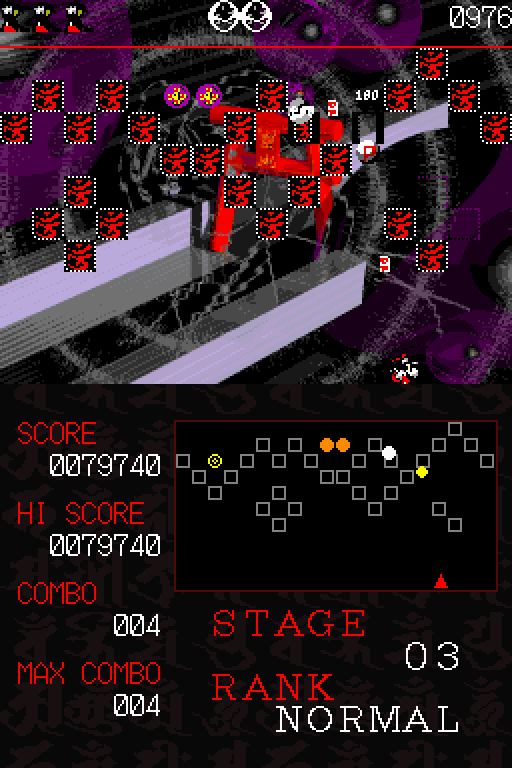
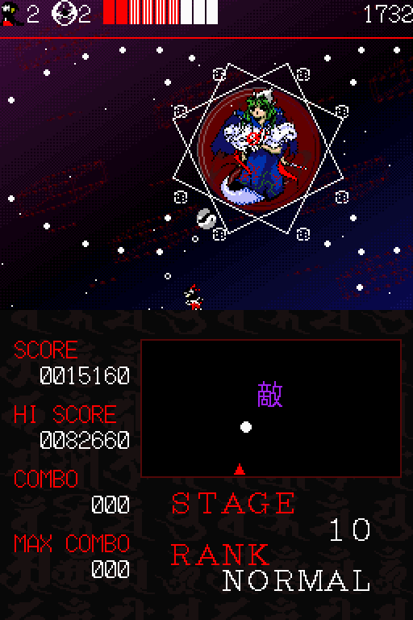

# Touhou Reiiden ~ The Highly Responsive to Prayers — DS port

A work-in-progress port of *Touhou Reiiden* (東方靈異伝 ～ The Highly Responsive to Prayers, 1997)
to the Nintendo DS, based on the game's fully decompiled source code at
[ReC98](https://github.com/nmlgc/ReC98) (`anniversary` branch).

## How to build

Requirements:

* G++ with C++17 support
* GNU Make 4.3 or newer
* Python 3.11 or newer, with NumPy and Pillow installed
* The Wonderful Toolchain package manager
  [(instructions)](https://wonderful.asie.pl/wiki/doku.php?id=getting_started)
* BlocksDS [(instructions)](https://blocksds.skylyrac.net/docs/setup/)
* An .hdi image containing HRtP, placed into `assets/th01.hdi`
* PC-98 drum samples in `assets/` as .wav files
* A PC-98 font file, placed into `assets/font.bmp`

Once everything is set up, simply type:

```bash
make
```

The rom file `hrtp_ds.nds` will then appear.

## Screenshots




## Checks

* `make test` — asset/font unit checks, gameplay/physics, source-pixel rendering,
  HUD/results and lifecycle regressions, plus all 16 music tracks and SFX.
* `make sanitize` — portable C++ harnesses under AddressSanitizer/UBSan, without
  repeating Python checks. Fixed-address audio service/diagnostic/music models
  remain normal-mode tests because their RAM mappings conflict with sanitizers.
* `make check-release` — build both ROMs and verify headers, icon, linked assets,
  exact NitroFS payloads and approved native-only audio. One disposable parallel
  clean-asset build checks serial/incremental recovery here, not on every test
  run; no host suite rerun.

For focused host runs, append `TEST_SUITE=gameplay`, `graphics` or `audio` to
`make test` or `make sanitize` (the default is `all`). `HOST_CXX` selects the host
compiler. Unchanged host executables and graphics fixtures are content-cached
under `build/`; assertions still run every time. `make clean` clears the cache.

## Current status

* [x] Display
  * [x] Bullets
  * [x] Lasers, thin and thick
  * [x] Missiles
  * [x] Bitmap background
  * [x] Tiles, turrets and barriers
  * [x] HUD
    * [x] Top screen HUD
    * [x] Bottom screen HUD
  * [x] Orb and boss arrows
  * [x] Font
* [x] Core gameplay
  * [x] Player controls
  * [x] Orb
  * [x] Bombs
  * [x] Damage and game over
  * [x] Pause screen
  * [x] Stage results
* [x] Music and SFX engine
  * [x] Music
  * [x] SFX
* [ ] Bosses
  * [x] SinGyoku
  * [x] YuugenMagan
  * [x] Mima
  * [ ] Elis
  * [x] Kikuri
  * [ ] Sariel
  * [x] Konngara
* [ ] Other screens
  * [ ] Start-up screen
  * [ ] Title screen and menu
  * [x] Round results
  * [ ] Endings and credits
  * [ ] Hero Scroll/score table/game over
* [ ] Miscellanea
  * [x] Icon
  * [ ] Smooth transitions (transitions to be added as scenes are added)
    * [x] Between two regular stages
    * [x] From a regular stage to a boss stage
    * [x] From boss defeat results to regular stage
    * [ ] From game over screen to regular stage
    * [ ] From game over screen to boss stage
    * [ ] From main menu to game

## Layout

* `source/engine/` — game logic (ported from ReC98 `th01/`, kept verbatim
  where validated)
* `source/platform/` — DS hardware layer (OAM renderers, tile/canvas/text
  layers, subscreen HUD, menus)
* `source/main.cpp` — entry point and the game loop
* `tools/` — asset converters, native audio tooling, local source dependencies
* `tests/` — code and asset tests
* `assets/` — original game data, plus extracted and converted assets
* `arm7/` — various ARM7-related BlocksDS services
* `native_audio/` — native DS music and SFX driver

## Controls

Current controls:
* **Left/Right** — move Reimu; **A** — swing gohei; **B** — shoot ofuda
  (and serve the orb at the start of a card stage)
* **X**, or **A + B twice** — bomb.
* **START** — pause/resume.
* **SELECT + d-pad** — dev stage navigator (←/→: stage, ↑/↓: scene;
  Shrine, Makai 6–10 and all Jigoku scenes have five stages;
  Makai 11–15 and 16–20 still have four)

## AI disclaimer

AI assistance is used throughout this codebase (tooling, engine, and platform
layers).

## Special thanks

### Original game and restoration

* **ZUN / ZUN Soft** — for *The Highly Responsive to Prayers*, its game design,
  artwork and music, and Touhou Project itself.
* **Nmlgc and the [ReC98](https://github.com/nmlgc/ReC98) contributors** — for
  the complete HRtP decompilation, documentation and `anniversary` fixes on
  which this port is based.
* **A. Koizuka and the master.lib contributors** — for the original PC-98
  support library, including the integer trigonometry ported through ReC98.
* **Regulus** — for the original [MDRV2 music system](https://www.vector.co.jp/soft/dos/art/se018677.html)
  and the audio format used by HRtP.

### Nintendo DS development

* **Antonio Niño Díaz and all the [BlocksDS](https://blocksds.skylyrac.net/)
  contributors** — for the SDK, project templates and NitroFS tutorial.
* **Michael Noland (joat), Jason Rogers (dovoto), Dave Murphy (WinterMute),
  Michael Chisholm (Chishm), and the libnds contributors** — for the DS
  hardware, filesystem and system libraries underlying the port.
* **ChaN** — for FatFs, used by the SDK's filesystem support.
* **Stephen Stair (sgstair), Dave Murphy, Max Thomas (ShinyQuagsire), Antonio
  Niño Díaz, and the DSWiFi contributors** — for the library used by the ARM7 core.
* **Adrian “asie” Siekierka and the [Wonderful Toolchain](https://wonderful.asie.pl/)
  contributors** — for the toolchain and development environment.
* **Martin Korth** — for [GBATEK](https://problemkaputt.de/gbatek.htm), the hardware
  reference used during development.

### Audio and asset tools

* **Aaron Giles and the [ymfm](https://github.com/aaronsgiles/ymfm) contributors** —
  for the Yamaha sound cores used on the host to render instrument and SFX PCM.
* **Lmocinemod** — for [MDT Parsing Tools](https://github.com/Lmocinemod/MDTParsingTools),
  whose retained decoder and portamento maps are used by the native audio build.
* **HertzDevil** — for the original [MDRV2 MDT-to-MML unconverter](https://gist.github.com/HertzDevil/036304c692b0f26b7a9d7cfe1126a0ac)
  on which that decoder is based.
* **Kirinn Bunnylin / Mooncore** — for [SuperSakura](https://gitlab.com/bunnylin/supersakura)
  and the Pi decoder from which the GRP conversion tools were ported.
* **Yanagisawa** — for the original Pi image format and its documentation.
* **The GCC, GNU binutils, GNU Make, Python, NumPy and Pillow contributors** —
  for compilation, host-side asset tools and validation;
  **the FreeType and HarfBuzz contributors** — for font
  rasterization and shaping used to prepare the fixed bitmap artwork.

### Fonts

* **Yuji Kataoka, Kinuta Font Factory and the Yuji Project authors** — for
  [Yuji Syuku](https://github.com/Kinutafontfactory/Yuji), used for the icon
  ([SIL Open Font License 1.1](assets/licenses/Yuji-OFL.txt)).
* **Pablo Impallari, Rodrigo Fuenzalida and the Libre Bodoni Project Authors** —
  for [Libre Bodoni](https://github.com/googlefonts/Libre-Bodoni), adapted as the
  round-results bitmap serif
  ([SIL Open Font License 1.1](assets/licenses/LibreBodoni-OFL.txt)).
* **Brian Swetland and Robey Pointer** — for the tiny 4×6 / Tom Thumb font
  underlying the 3×5 playfield text.
* **pk / PK** — for the [packed tiny font and retrieval routine](https://hackaday.io/project/6309-vga-graphics-over-spi-and-serial-vgatonic/log/20759-a-tiny-4x6-pixel-font-that-will-fit-on-almost-any-microcontroller-license-mit)
  from VGATonic; **Leonhard Seidel (CamelCaseName)** — for the
  [HUB75nano font adaptation](https://github.com/CamelCaseName/HUB75nano/blob/master/src/fonts/3x5font.h)
  used as this port's immediate reference.
