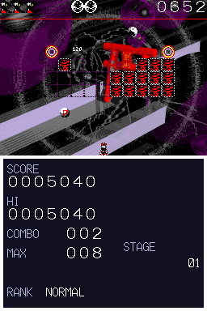
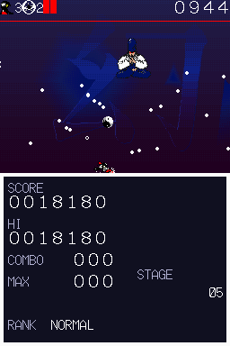

# Touhou Reiiden ~ The Highly Responsive to Prayers — DS port

A work-in-progress port of *Touhou Reiiden* (東方靈異伝　～ The Highly Responsive to Prayers, 1997)
to the Nintendo DS, based on the game's fully decompiled source code at
[ReC98](https://github.com/nmlgc/ReC98) (`anniversary` branch).

## How to build

Requirements:

* G++ with C++17 support
* GNU Make 4.3 or newer
* Python 3.11 or newer, with NumPy and Pillow installed
* The Wonderful Toolchain package manager
  [(instructions)](https://wonderful.asie.pl/wiki/doku.php?id=getting_started)
* BlocksDS [(instructions)](https://blocksds.skylyrac.net/docs/setup/)
* An .hdi image containing HRtP, placed into `assets/th01.hdi`
* PC-98 drum samples in `assets/` as .wav files
* A PC-98 font file, placed into `assets/font.bmp`

Once everything is set up, simply type:

```bash
make
```

The rom file `hrtp_ds.nds` will then appear.

## Screenshots




## Checks

* `make test` — asset/font unit checks, gameplay/physics, source-pixel rendering,
  HUD/results and lifecycle regressions, plus all 16 music tracks and SFX.
* `make sanitize` — portable C++ harnesses under AddressSanitizer/UBSan, without
  repeating Python checks. Fixed-address audio service/diagnostic/music models
  remain normal-mode tests because their RAM mappings conflict with sanitizers.
* `make check-release` — build both ROMs and verify headers, icon, linked assets,
  exact NitroFS payloads and approved native-only audio; no host suite rerun.

For focused host runs, append `TEST_SUITE=gameplay`, `graphics` or `audio` to
`make test` or `make sanitize` (the default is `all`). `HOST_CXX` selects the host
compiler. Unchanged host executables and graphics fixtures are content-cached
under `build/`; assertions still run every time. `make clean` clears the cache.
Feature cases stay in small modules, with packaging assertions in one place.

## Current status

* [ ] Display
  * [x] Bullets
  * [x] Lasers, thin and thick
  * [ ] Missiles
  * [x] Bitmap background
  * [x] Tiles, turrets and barriers
  * [x] HUD
    * [x] Top screen HUD
    * [x] Bottom screen HUD
  * [x] Font
* [x] Core gameplay
  * [x] Player controls
  * [x] Orb
  * [x] Bombs
  * [x] Damage and game over
  * [x] Pause screen
  * [x] Stage results
* [x] Music and SFX engine
  * [x] Music
  * [x] SFX
* [ ] Bosses
  * [x] SinGyoku
  * [ ] YuugenMagan
  * [ ] Mima
  * [ ] Elis
  * [ ] Kikuri
  * [ ] Sariel
  * [x] Konngara
* [ ] Other screens
  * [ ] Start-up screen
  * [ ] Title screen and menu
  * [x] Round results
  * [ ] Endings and credits
  * [ ] Hero Scroll/score table/game over
* [ ] Miscellanea
  * [x] Icon
  * [ ] Smooth transitions
    * [ ] Between two regular stages
    * [ ] From a regular stage to a boss stage
    * [ ] Resetting a boss stage
    * [ ] Resetting a regular stage
    * [ ] From boss defeat results to regular stage

## Layout

* `source/engine/` — game logic (ported from ReC98 `th01/`, kept verbatim
  where validated)
* `source/platform/` — DS hardware layer (OAM renderers, tile/canvas/text
  layers, subscreen HUD, menus)
* `source/main.cpp` — entry point and the game loop
* `tools/` — asset converters, native audio tooling, local source dependencies
* `tests/` — code and asset tests
* `assets/` — original game data, plus extracted and converted assets
* `arm7/` — various ARM7-related BlocksDS services
* `native_audio/` — native DS music and SFX driver

## Controls

Current controls:
* **Left/Right** — move Reimu; **A** — swing gohei; **B** — shoot ofuda
  (and serve the orb at the start of a card stage)
* **X**, or **A + B twice** — bomb.
* **START** — pause/resume.
* **SELECT + d-pad** — dev stage navigator (←/→: stage, ↑/↓: scene;
  Shrine and the last Jigoku scene have five stages, other scenes four)

## AI disclaimer

AI assistance is used throughout this codebase (tooling, engine, and platform
layers).

## Special thanks

* **Nmlgc** and the ReC98 contributors — for the complete decompilation of HRtP
* **All the BlocksDS contributors** — for the SDK that makes this port possible
* **ZUN** — for Touhou Project itself
* **Yuji Kataoka, Kinuta Font Factory and the Yuji Project authors** — for
  [Yuji Syuku](https://github.com/Kinutafontfactory/Yuji), used for the icon
  ([SIL Open Font License 1.1](assets/licenses/Yuji-OFL.txt))
